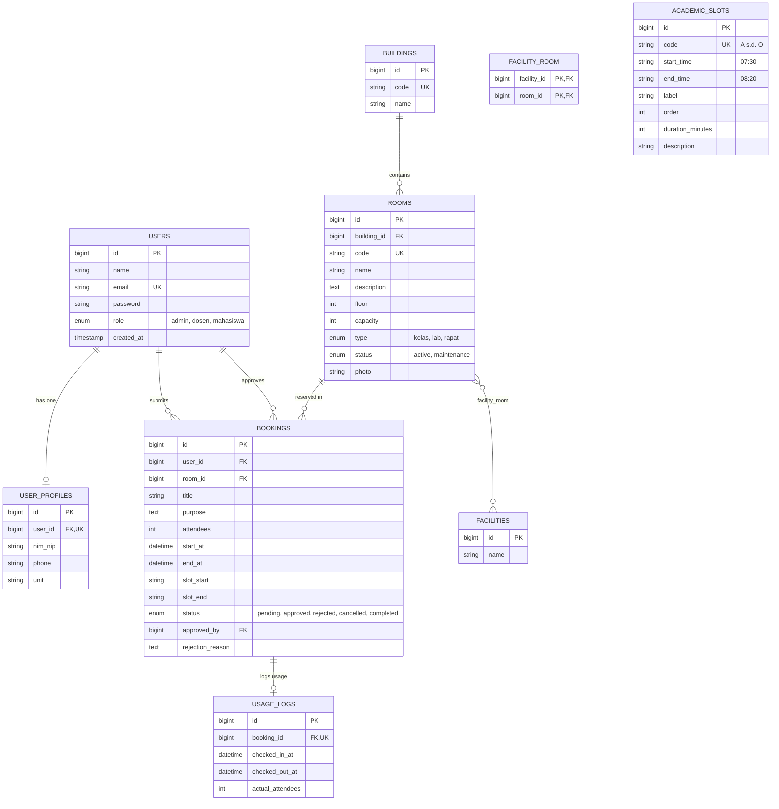

# SDP Room Booking API — Undiksha Denpasar

> **Layanan RESTful API Skala Produksi untuk Pemantauan dan Pemesanan Ruangan Kampus Undiksha Denpasar Berbasis SKS & Concurrency Control**

---

## 1. Judul & Identitas

| Informasi          | Keterangan                                                        |
| :----------------- | :---------------------------------------------------------------- |
| **Nama Proyek**    | Sistem Pemantauan & Pemesanan Ruangan Kampus (_sdp-room-booking_) |
| **Mata Kuliah**    | Teknologi Web (Semester 5)                                        |
| **Institusi**      | Universitas Pendidikan Ganesha - Kampus Denpasar                  |
| **Pengembang**     | I Nyoman Yogi Artawan (NIM: 2415101060)                           |
| **Dosen Pengampu** | Ir. Ketut Agus Seputra, S.ST.,M.T.                                |
| **Tahun Ajaran**   | 2026/2027                                                         |

---

## 2. Deskripsi Singkat

Sistem Informasi Pemantauan dan Pemesanan Ruangan (_sdp-room-booking_) adalah layanan RESTful API berskala produksi yang dirancang untuk mengatasi permasalahan bentrok jadwal (_double-booking_), inefisiensi pencatatan manual, dan ketiadaan transparansi ketersediaan ruangan perkuliahan di lingkungan Kampus Undiksha Denpasar. Sistem ini menyediakan endpoint pertukaran data JSON yang aman dan cepat untuk menghubungkan mahasiswa, dosen, dan bagian tata usaha/admin dalam satu alur bisnis terpadu: mulai dari pengecekan ketersediaan slot waktu SKS, pengajuan peminjaman ruangan, approval berjenjang, hingga pencatatan log penggunaan aktual ruangan secara _real-time_.

---

## 3. Fitur Aplikasi

Fitur dikelompokkan ke dalam 5 domain utama:

### A. Autentikasi & Akun `[MVP]`

- **Register API**: Registrasi publik khusus untuk role `mahasiswa` dan `dosen`.
- **Login API**: Autentikasi kredensial dilengkapi _rate limiting / throttling_ (maks. 10 percobaan/menit) untuk mencegah _brute-force attack_.
- **Token Management**: Pemanfaatan Bearer Token Laravel Sanctum dengan kemampuan _single-token revoke_ saat logout.
- **Profile Endpoint**: Mengambil data diri pengguna beserta profil akademik (NIM/NIP, unit, nomor telepon).

### B. Master Data & Fasilitas `[MVP]`

- **Manajemen Gedung**: CRUD master gedung perkuliahan (Gedung R.A. Kartini, Gedung Ki Hadjar Dewantara, Gedung Utama).
- **Manajemen Fasilitas**: CRUD fasilitas pendukung (Proyektor 4K, AC, Sound System, Smart TV, Whiteboard, WiFi 6).
- **Kamus Slot SKS (Slots A s.d. O)**: Endpoint penyedia kamus waktu akademik resmi Undiksha (1 SKS = 50 menit, 07:30 s.d. 22:00 WITA).

### C. Manajemen Ruangan & Siklus Berkas (File Storage) `[MVP]`

- **Katalog Ruangan**: Menampilkan daftar 27 ruangan resmi dengan filter gedung, jenis ruangan, status operasional, dan kapasitas.
- **Upload Foto Ruangan**: Validasi MIME type (`jpeg, png, jpg, webp`) dan ukuran berkas (maks. 2MB) yang disimpan ke `storage/app/public/rooms/`.
- **Public Storage Symlink**: Akses langsung berkas melalui URL publik yang disajikan via accessor `photo_url`.
- **Pembersihan Berkas Otomatis (_Orphan Prevention_)**: Menghapus file fisik foto lama saat data ruangan di-update atau dihapus.

### D. Alur Pemesanan Ruangan & Anti Double-Booking `[MVP]`

- **Pengajuan Booking**: Pemesanan ruangan berstatus `pending` dengan validasi kapasitas dan jam operasional kampus.
- **Pencegahan Bentrok (_Pessimistic Locking_)**: Pengecekan overlap jadwal di dalam `DB::transaction()` dengan `lockForUpdate()` yang mengembalikan **HTTP 409 Conflict** jika terjadi bentrok.
- **Approval & Rejection Admin**: Admin dapat menyetujui (_re-check conflict_) atau menolak pengajuan (wajib menyertakan alasan penolakan).
- **Pembatalan Pengguna**: Pengguna dapat membatalkan pemesanan miliknya sebelum jadwal perkuliahan dimulai.

### E. Monitoring & Presensi Ruangan

- **Check-in & Check-out**: Pencatatan waktu aktual kedatangan dan kepulangan pada tabel `usage_logs`.
- **Ketersediaan Ruangan**: Pengecekan slot terpakai per tanggal (`GET /rooms/{id}/availability?date=YYYY-MM-DD`).
- **Dashboard Metrik Admin**: Ringkasan total ruangan aktif, pemeliharaan, pemesanan hari ini, dan statistik ruangan terpopuler.

---

## 4. Tabel Pemetaan Tugas → Implementasi

| Requirement Tugas               | Implementasi pada Proyek                                                                                          |     Status      |
| :------------------------------ | :---------------------------------------------------------------------------------------------------------------- | :-------------: |
| **Migration, Seeder, Eloquent** | Seluruh tabel migrasi bersih di MariaDB beserta `InitialDataSeeder` data resmi Undiksha                           | `[MVP] Selesai` |
| **Relasi 1-to-1**               | `User` ↔ `UserProfile`, `Booking` ↔ `UsageLog`                                                                    | `[MVP] Selesai` |
| **Relasi 1-to-N**               | `Building` → `Room`, `Room` → `Booking`, `User` → `Booking`                                                       | `[MVP] Selesai` |
| **Relasi N-to-N**               | `Room` ↔ `Facility` melalui tabel pivot `facility_room`                                                           | `[MVP] Selesai` |
| **TCL `DB::transaction`**       | Transaksi atomik pembuatan booking, approval, dan registrasi profil                                               | `[MVP] Selesai` |
| **Pessimistic Locking**         | Penguncian baris `lockForUpdate()` saat pengecekan bentrok jadwal                                                 | `[MVP] Selesai` |
| **RBAC Gate & Policy**          | `BookingPolicy`, `RoomPolicy`, Gate `manage-master-data`, `approve-booking`, `view-dashboard`                     | `[MVP] Selesai` |
| **API Resources**               | `UserResource`, `RoomResource`, `BookingResource`, `BuildingResource`, `FacilityResource`, `AcademicSlotResource` | `[MVP] Selesai` |
| **Autentikasi Token**           | Laravel Sanctum (Bearer Token) pada endpoint `/register`, `/login`, `/logout`, `/profile`                         | `[MVP] Selesai` |
| **Form Request & HTTP 422**     | Isolasi validasi pada `ApiRegisterRequest`, `StoreRoomRequest`, `StoreBookingRequest`, dll.                       | `[MVP] Selesai` |
| **Upload Berkas & Storage**     | Penyimpanan foto ruangan di disk `public` lengkap dengan penghapusan berkas usang                                 | `[MVP] Selesai` |
| **Search, Filter, Pagination**  | Query search `q`, filter `building_id`, `type`, `status`, pagination pada Rooms & Bookings                        | `[MVP] Selesai` |
| **Pengujian & Koleksi API**     | File interaktif `tests/api/sdp_room_booking.http` dan 31 Feature Tests otomatis Pest/PHPUnit                      | `[MVP] Selesai` |

---

## 5. Teknologi & Kebutuhan Lingkungan

- **Bahasa Pemrograman**: PHP 8.3 / PHP 8.5
- **Framework Utama**: Laravel 12.x
- **Database Engine**: MariaDB 11.4 LTS (dijalankan terisolasi via Docker Compose)
- **Token Security**: Laravel Sanctum v4
- **Starter Kit & Styling**: Laravel Breeze (Blade Engine) & Tailwind CSS v3
- **Testing Framework**: Pest PHP v5 & PHPUnit v11
- **API Tooling**: REST Client (`.http`) / Postman

---

## 6. Arsitektur Sistem

Sistem mengadopsi arsitektur _Three-Tier Architecture_ dengan pemisahan tanggung jawab yang tegas:

```
[ Klien: Postman / Browser / Mobile App ]
                   │
                   ▼ (HTTP JSON Request / Bearer Token)
[ Presentation Tier: Routing & Middleware ]
  ├── routes/api.php (Prefix /api/v1)
  ├── Throttle Middleware (Rate-limiting brute force)
  └── Sanctum Middleware (auth:sanctum token check)
                   │
                   ▼
[ Logic Tier: Controllers, FormRequests, Policies & Resources ]
  ├── FormRequests (Validasi input & Response 422 terstruktur)
  ├── Controllers (Orkestrasi alur bisnis)
  │     ├── ApiResponse Trait (Standard JSON Envelope)
  │     └── DB::transaction + lockForUpdate() (Pencegahan double-booking)
  ├── Policies & Gates (Otorisasi peran / RBAC)
  └── API Resources (Serialisasi & transformasi data JSON)
                   │
                   ▼
[ Data Tier: Persistent Storage & Cache ]
  ├── MariaDB 11.4 Container (Tabel relasional & indeks komposit)
  └── Storage Engine (storage/app/public/rooms via public/storage symlink)
```

---

## 7. ERD & Skema Database



> **Indeks Kritis**: Tabel `bookings` dilengkapi indeks komposit `$table->index(['room_id', 'start_at', 'end_at'])` untuk menjamin kecepatan evaluasi _query overlap_ jadwal pada skala jutaan baris data.

---

## 8. Panduan Instalasi & Menjalankan Proyek

Ikuti langkah-langkah berikut untuk menjalankan sistem dari awal:

### Prasyarat:

- PHP >= 8.3
- Composer >= 2.0
- Docker & Docker Compose
- Node.js & NPM

### Langkah Instalasi:

```bash
# 1. Clone repositori
git clone https://github.com/username/sdp-room-booking.git
cd sdp-room-booking

# 2. Install dependensi PHP
composer install

# 3. Salin file environment
cp .env.example .env

# 4. Generate Application Key
php artisan key:generate

# 5. Jalankan Container MariaDB via Docker Compose
docker compose up -d

# 6. Pastikan konfigurasi database di .env mengarah ke port 3307:
# DB_CONNECTION=mariadb
# DB_HOST=127.0.0.1
# DB_PORT=3307
# DB_DATABASE=sdp_room_booking
# DB_USERNAME=sdp_user
# DB_PASSWORD=sdp_password
# FILESYSTEM_DISK=public

# 7. Jalankan Migrasi Bersih & Seeder Data Resmi
php artisan migrate:fresh --seed

# 8. Buat Symlink Storage (Penting untuk upload foto)
php artisan storage:link

# 9. Install dependensi frontend dan build asset Breeze
npm install
npm run build

# 10. Jalankan Web Server Laravel
php artisan serve
```

Aplikasi backend API sekarang aktif dan dapat diakses di: **`http://127.0.0.1:8000`**.

---

## 9. Akun Demo Pengujian (Seeder)

Semua akun pengujian di bawah ini dibuat otomatis saat menjalankan seeder dengan password default: **`password`**.

| Role          | Nama Pengguna          | Email                   | Identitas (NIM/NIP) | Unit / Jurusan                |
| :------------ | :--------------------- | :---------------------- | :------------------ | :---------------------------- |
| **Admin**     | Administrator Undiksha | `admin@undiksha.ac.id`  | 198501012010121001  | UPT TIK Undiksha              |
| **Dosen**     | Dr. I Gede Made, M.Cs. | `dosen1@undiksha.ac.id` | 197903152005011002  | Pendidikan Teknik Informatika |
| **Dosen**     | Ni Wayan Sukma, M.T.   | `dosen2@undiksha.ac.id` | 198807202015042001  | Sistem Informasi              |
| **Mahasiswa** | I Putu Arya Mahasiswa  | `mhs1@undiksha.ac.id`   | 2215101001          | Ilmu Komputer                 |
| **Mahasiswa** | Kadek Ayu Lestari      | `mhs2@undiksha.ac.id`   | 2215101002          | Sistem Informasi              |
| **Mahasiswa** | Komang Agus Wijaya     | `mhs3@undiksha.ac.id`   | 2215101003          | Pendidikan Teknik Informatika |

---

## 10. Dokumentasi RESTful API

**Base URL**: `http://127.0.0.1:8000/api/v1`  
**Header Wajib untuk Request Terproteksi**:

- `Authorization: Bearer <token>`
- `Accept: application/json`

### Daftar Lengkap Endpoint:

| Method        | Endpoint URL               | Hak Akses   | Deskripsi & Fungsi                                           |
| :------------ | :------------------------- | :---------- | :----------------------------------------------------------- |
| **POST**      | `/register`                | Publik      | Mendaftarkan akun mahasiswa atau dosen                       |
| **POST**      | `/login`                   | Publik      | Autentikasi akun & penerbitan Bearer Token (Throttle 10/min) |
| **POST**      | `/logout`                  | Auth        | Mencabut token aktif pengguna                                |
| **GET**       | `/profile`                 | Auth        | Mendapatkan rincian data pengguna login                      |
| **GET**       | `/slots`                   | Publik      | Mendapatkan kamus 15 slot waktu SKS resmi (A s.d. O)         |
| **GET**       | `/buildings`               | Publik      | Menampilkan daftar seluruh gedung perkuliahan                |
| **POST**      | `/buildings`               | Admin       | Menambahkan gedung baru                                      |
| **GET**       | `/buildings/{id}`          | Auth        | Melihat rincian gedung                                       |
| **PUT/PATCH** | `/buildings/{id}`          | Admin       | Memperbarui data gedung                                      |
| **DELETE**    | `/buildings/{id}`          | Admin       | Menghapus gedung (jika tidak memiliki ruangan aktif)         |
| **GET**       | `/facilities`              | Publik      | Menampilkan daftar fasilitas kampus                          |
| **POST**      | `/facilities`              | Admin       | Menambahkan fasilitas baru                                   |
| **GET**       | `/facilities/{id}`         | Auth        | Melihat rincian fasilitas                                    |
| **PUT/PATCH** | `/facilities/{id}`         | Admin       | Memperbarui fasilitas                                        |
| **DELETE**    | `/facilities/{id}`         | Admin       | Menghapus fasilitas                                          |
| **GET**       | `/rooms`                   | Publik      | Menampilkan daftar ruangan (Search, Filter, Pagination)      |
| **POST**      | `/rooms`                   | Admin       | Menambahkan ruangan baru + upload foto multipart             |
| **GET**       | `/rooms/{id}`              | Publik      | Menampilkan detail ruangan, fasilitas, dan foto URL          |
| **POST**      | `/rooms/{id}`              | Admin       | Memperbarui ruangan & mengganti foto (Multipart Form-Data)   |
| **DELETE**    | `/rooms/{id}`              | Admin       | Menghapus ruangan & membersihkan file foto dari storage      |
| **GET**       | `/rooms/{id}/availability` | Publik      | Melihat slot waktu terpakai pada tanggal tertentu            |
| **GET**       | `/bookings`                | Auth        | Menampilkan pemesanan (Admin: semua, User: milik sendiri)    |
| **POST**      | `/bookings`                | Auth        | Mengajukan pemesanan baru (Dengan proteksi bentrok)          |
| **GET**       | `/bookings/{id}`           | Owner/Admin | Melihat rincian pemesanan ruangan                            |
| **PATCH**     | `/bookings/{id}/approve`   | Admin       | Menyetujui pemesanan (Atomik re-check overlap)               |
| **PATCH**     | `/bookings/{id}/reject`    | Admin       | Menolak pemesanan (Wajib menyertakan alasan)                 |
| **PATCH**     | `/bookings/{id}/cancel`    | Owner       | Membatalkan pemesanan sebelum waktu pelaksanaan              |
| **POST**      | `/bookings/{id}/check-in`  | Owner/Admin | Mencatat waktu mulai penggunaan ruangan                      |
| **POST**      | `/bookings/{id}/check-out` | Owner/Admin | Mencatat selesai penggunaan & menandai `completed`           |
| **GET**       | `/dashboard/summary`       | Admin       | Ringkasan metrik statistik pemakaian ruangan kampus          |
| **GET**       | `/dashboard/utilization`   | Admin       | Statistik utilisasi gedung dan ruangan terpopuler            |

---

## 11. Format Response & Penanganan Error

Seluruh response API distandarisasi menggunakan _Response Envelope_ seragam melalui [`ApiResponse`](file:///home/nyomanyogi29/Documents/kuliah/semester-5/teknologi-web/tugas-laravel/sdp-room-booking/app/Traits/ApiResponse.php) trait dan _Global Exception Handling_ di [`bootstrap/app.php`](file:///home/nyomanyogi29/Documents/kuliah/semester-5/teknologi-web/tugas-laravel/sdp-room-booking/bootstrap/app.php).

### Format Sukses Standar (HTTP 200 / 201):

```json
{
    "success": true,
    "message": "Pemesanan ruangan berhasil diajukan dan menunggu persetujuan admin",
    "data": {
        "id": 10,
        "title": "Praktikum Jaringan Komputer",
        "status": "pending",
        "start_at": "2026-10-25T08:30:00.000000Z",
        "end_at": "2026-10-25T11:20:00.000000Z",
        "slot_start": "B",
        "slot_end": "D"
    }
}
```

### Tabel Status Code HTTP yang Digunakan:

| Kode HTTP | Status               | Arti & Penggunaan pada Sistem                                               |
| :-------: | :------------------- | :-------------------------------------------------------------------------- |
| **`200`** | OK                   | Permintaan berhasil diproses (misal: get data, update, logout)              |
| **`201`** | Created              | Data entitas baru berhasil disimpan (misal: register, create room, booking) |
| **`401`** | Unauthorized         | Klien tidak menyertakan token atau token telah usang / dicabut              |
| **`403`** | Forbidden            | Token valid, namun peran (_role_) pengguna tidak memiliki hak akses (RBAC)  |
| **`404`** | Not Found            | Entitas atau endpoint tidak ditemukan di sistem                             |
| **`409`** | Conflict             | Terjadi bentrok jadwal pemesanan ruangan pada rentang waktu yang sama       |
| **`422`** | Unprocessable Entity | Validasi input FormRequest gagal (tipe data, berkas gambar, kapasitas)      |
| **`500`** | Server Error         | Kesalahan internal server (tercatat di `storage/logs/laravel.log`)          |

### Contoh Format Error Validasi (HTTP 422):

```json
{
    "success": false,
    "message": "Validasi data gagal.",
    "errors": {
        "attendees": [
            "Jumlah peserta (60) melebihi batas kapasitas maksimal ruangan (40)."
        ],
        "photo": [
            "Berkas photo harus berupa gambar dengan format: jpeg, png, jpg, webp."
        ]
    }
}
```

### Contoh Format Error Bentrok Jadwal (HTTP 409):

```json
{
    "success": false,
    "message": "Ruangan telah dipesan atau diajukan pada rentang waktu yang dipilih.",
    "conflict": {
        "existing_booking_id": 1,
        "title": "Kuliah Rekayasa Web (3 SKS)",
        "start_at": "2026-10-21T07:30:00.000000Z",
        "end_at": "2026-10-21T10:20:00.000000Z",
        "status": "approved"
    }
}
```

---

## 12. Autentikasi & Otorisasi (RBAC)

### Alur Autentikasi:

1. Pengguna mengirim kredensial email & password ke `POST /api/v1/login`.
2. Controller memvalidasi kecocokan password menggunakan `Hash::check()`.
3. Token API diterbitkan melalui metode bawaan Sanctum: `$user->createToken('auth_token')->plainTextToken`.
4. Klien menyertakan token ini pada setiap permintaan berikutnya di header HTTP:
   `Authorization: Bearer <token_string>`
5. Saat `POST /api/v1/logout`, token aktif pengguna langsung dihapus dari tabel `personal_access_tokens`.

### Matriks Otorisasi Peran (RBAC Matrix):

| Modul / Tindakan Endpoint                       |      Mahasiswa      |        Dosen        |      Admin      |
| :---------------------------------------------- | :-----------------: | :-----------------: | :-------------: |
| **Melihat Daftar & Detail Ruangan**             |      ✅ `200`       |      ✅ `200`       |    ✅ `200`     |
| **Melihat Kamus Slot SKS Akademik**             |      ✅ `200`       |      ✅ `200`       |    ✅ `200`     |
| **Tambah, Update, Hapus Ruangan (Master Data)** |      ❌ `403`       |      ❌ `403`       |  ✅ `200/201`   |
| **Upload / Ganti Foto Ruangan**                 |      ❌ `403`       |      ❌ `403`       |    ✅ `200`     |
| **Tambah, Update, Hapus Gedung & Fasilitas**    |      ❌ `403`       |      ❌ `403`       |  ✅ `200/201`   |
| **Mengajukan Pemesanan Ruangan**                |      ✅ `201`       |      ✅ `201`       |    ✅ `201`     |
| **Melihat Daftar Booking**                      | Hanya Milik Sendiri | Hanya Milik Sendiri | Seluruh Booking |
| **Membatalkan Booking Sendiri**                 |      ✅ `200`       |      ✅ `200`       |    ✅ `200`     |
| **Menyetujui (Approve) Booking**                |      ❌ `403`       |      ❌ `403`       |    ✅ `200`     |
| **Menolak (Reject) Booking**                    |      ❌ `403`       |      ❌ `403`       |    ✅ `200`     |
| **Melihat Ringkasan & Utilisasi Dashboard**     |      ❌ `403`       |      ❌ `403`       |    ✅ `200`     |

---

## 13. Aturan Bisnis Penting (Business Logic)

1. **Pencegahan Double-Booking (Concurrency Control)**:
    - Dilarang keras terdapat 2 pemesanan pada ruangan yang sama dan rentang waktu yang beririsan.
    - Pengecekan irisan waktu menggunakan rumus matematika interval:
      $$\text{existing.start\_at} < \text{request.end\_at} \quad \text{AND} \quad \text{existing.end\_at} > \text{request.start\_at}$$
    - Status pemesanan yang diperhitungkan sebagai bentrok adalah `pending` dan `approved` (mengabaikan `rejected` dan `cancelled`).
    - Pengecekan dibungkus di dalam **`DB::transaction()`** bersama klausa **`lockForUpdate()`**. Hal ini mengunci baris database secara atomik untuk mencegah _race condition_ jika ada dua mahasiswa yang menekan tombol _submit_ di detik yang bersamaan.
2. **Kesesuaian Kapasitas Ruangan**:
    - Jumlah peserta (`attendees`) yang diajukan tidak boleh melampaui kapasitas fisik ruangan (`capacity`).
3. **Status Operasional Ruangan**:
    - Ruangan yang berstatus `maintenance` (perbaikan) secara otomatis ditolak oleh validasi sistem saat diajukan peminjaman.
4. **Batas Jam Operasional Kampus**:
    - Peminjaman dibatasi dalam rentang jam operasional resmi Undiksha, yaitu pukul 07:00 hingga 22:00 WITA (selaras dengan Slot A sampai Slot O).

---

## 14. Pengujian API & Koleksi HTTP

### Cara Menjalankan Pengujian Manual via REST Client:

Dokumentasi interaktif siap eksekusi tersedia pada berkas [**`tests/api/sdp_room_booking.http`**](file:///home/nyomanyogi29/Documents/kuliah/semester-5/teknologi-web/tugas-laravel/sdp-room-booking/tests/api/sdp_room_booking.http).

1. Buka file tersebut menggunakan ekstensi **REST Client** di Visual Studio Code.
2. Klik tombol **`Send Request`** pada blok `1.1 Login Admin`. Variabel `@adminToken` akan otomatis terisi.
3. Jalankan skenario pemesanan, upload foto ruangan multipart, verifikasi respon bentrok 409, hingga simulasi penolakan RBAC 403.

### Pengujian Otomatis (Feature Tests):

Eksekusi unit dan feature test otomatis menggunakan framework Pest/PHPUnit:

```bash
php artisan test
```

**Hasil Pengujian Otomatis (100% PASS)**:

```text
   PASS  Tests\Feature\Api\RoomBookingApiTest
  ✓ it can register via api
  ✓ it cannot register as admin
  ✓ it handles login and logout
  ✓ it handles storage lifecycle upload update and delete room photo
  ✓ it handles booking concurrency and double booking conflict (409)
  ✓ it handles rbac approval and checkin flow

  Tests:    31 passed (102 assertions)
  Duration: 1.48s
```

---

## 15. Struktur Direktori Utama

Berikut adalah ringkasan struktur berkas dan modul kustom yang dibangun pada proyek ini:

```
app/
├── Http/
│   ├── Controllers/
│   │   └── Api/
│   │       └── V1/
│   │           ├── AcademicSlotController.php  <-- Endpoint kamus slot SKS
│   │           ├── AuthController.php          <-- Register, login, logout, profile
│   │           ├── BookingController.php       <-- Transaksi booking & anti double-booking
│   │           ├── BuildingController.php      <-- CRUD master gedung
│   │           ├── DashboardController.php     <-- Metrik utilisasi admin
│   │           ├── FacilityController.php      <-- CRUD fasilitas
│   │           └── RoomController.php          <-- CRUD ruangan & siklus berkas foto
│   ├── Requests/
│   │   ├── Auth/ (ApiRegisterRequest.php, ApiLoginRequest.php)
│   │   ├── Booking/ (StoreBookingRequest.php, RejectBookingRequest.php, dll.)
│   │   ├── Building/ (BuildingRequest.php)
│   │   ├── Facility/ (FacilityRequest.php)
│   │   └── Room/ (StoreRoomRequest.php, UpdateRoomRequest.php)
│   └── Resources/
│       ├── AcademicSlotResource.php
│       ├── BookingResource.php
│       ├── BuildingResource.php
│       ├── FacilityResource.php
│       ├── RoomResource.php
│       ├── UsageLogResource.php
│       └── UserResource.php
├── Models/
│   ├── AcademicSlot.php
│   ├── Booking.php
│   ├── Building.php
│   ├── Facility.php
│   ├── Room.php
│   ├── UsageLog.php
│   ├── User.php
│   └── UserProfile.php
├── Policies/
│   ├── BookingPolicy.php
│   └── RoomPolicy.php
└── Traits/
    └── ApiResponse.php                         <-- Standarisasi JSON envelope

database/
├── migrations/                                 <-- 13 skema migrasi tabel & indeks
└── seeders/
    ├── DatabaseSeeder.php
    └── InitialDataSeeder.php                   <-- Data resmi 27 ruangan, 3 gedung, 15 slot SKS

routes/
├── api.php                                     <-- Seluruh rute REST API /api/v1
└── web.php                                     <-- Rute web & status info

tests/
├── Feature/
│   └── Api/
│       └── RoomBookingApiTest.php              <-- Test suite otomatis
└── api/
    └── sdp_room_booking.http                   <-- Koleksi pengujian HTTP interaktif
```

---

## 16. Keputusan Desain Arsitektur

1. **Pemilihan HTTP 409 Conflict vs 422 Unprocessable Entity**:
    - Kode **422** digunakan murni untuk kesalahan sintaksis atau format payload masukan pengguna (misal: email salah format, field kosong, atau peserta melebihi kapasitas).
    - Kode **409** secara semantik RESTful digunakan khusus untuk bentrok konkurensi jadwal (_resource state conflict_), di mana format data pengguna sudah valid, namun bentrok dengan status data pemesanan lain di server.
2. **Penyimpanan Lokal Disk `public` vs Layanan CDN Pihak Ketiga**:
    - Dipilih disk lokal `public` dengan _symlink_ agar aplikasi bersifat _self-contained_, tidak bergantung pada _third-party service credentials_ yang rentan kadaluarsa saat evaluasi pengujian oleh dosen, serta menjamin pembersihan file usang bekerja secara deterministik.
3. **Penyediaan Kamus Slot Waktu SKS (Slot A s.d. O)**:
    - Kampus Undiksha menggunakan sistem perkuliahan berbasis blok SKS (50 menit/SKS). Menyediakan tabel dan endpoint khusus slot mempermudah integrasi dengan antarmuka frontend/mobile tanpa perlu kalkulasi manual jam perkuliahan di sisi klien.

---

## 17. Batasan Sistem & Rencana Pengembangan Lanjutan

### Batasan Sistem Saat Ini (_Out of Scope_):

- Sistem belum dilengkapi pengiriman notifikasi instan melalui email/WhatsApp (misalnya via Mailgun/FCM).
- Sistem belum mengintegrasikan modul pembayaran/retribusi sewa gedung umum (_Payment Gateway_).
- Sistem berfokus penuh pada penyediaan RESTful API inti (antarmuka visual kalender _drag-and-drop_ disiapkan untuk tahap frontend lanjutan).

### Rencana Pengembangan Lanjutan:

- Integrasi _Websocket_ (Laravel Reverb) untuk pembaruan ketersediaan ruangan secara _real-time_ tanpa refresh.
- Pembuatan antarmuka visual kalender jadwal menggunakan FullCalendar / Tailwind UI.
- Implementasi sistem check-in berbasis QR Code dinamis di depan pintu ruangan.

---

## 18. Lembar Checklist Evaluasi Modul

- [x] Lingkungan Composer, Docker MariaDB, dan migrasi database berjalan bersih
- [x] Seluruh relasi Eloquent ORM (1-1, 1-N, N-N) terhubung dengan benar
- [x] Format response JSON konsisten di seluruh endpoint via Eloquent API Resource
- [x] Upload, update, dan delete berkas foto ruangan bekerja dengan pembersihan file fisik
- [x] Mekanisme autentikasi token Laravel Sanctum aktif dan terproteksi _rate limiting_
- [x] Validasi Form Request terisolasi dengan penanganan respon HTTP 422 terstruktur
- [x] Fitur search, filter bertingkat, dan pagination bekerja simultan
- [x] Otorisasi hak akses berbasis peran (RBAC via Gate & Policy) teruji (HTTP 403)
- [x] Kontrol transaksi konkurensi (`DB::transaction` + `lockForUpdate`) mencegah _double-booking_
- [x] Seluruh endpoint terdokumentasi rapi di koleksi `.http` dan lulus seluruh unit/feature test

---

## 19. Referensi

1. [Dokumentasi Resmi Laravel 12.x](https://laravel.com/docs/12.x)
2. [Laravel Sanctum Authentication Guide](https://laravel.com/docs/12.x/sanctum)
3. [Laravel File Storage & Visibility](https://laravel.com/docs/12.x/filesystem)
4. Modul Praktikum Teknologi Web: _BAB III REST API, Authentication, and Concurrency Control_
5. Buku Panduan Akademik Universitas Pendidikan Ganesha (Pedoman Jam Perkuliahan SKS)
